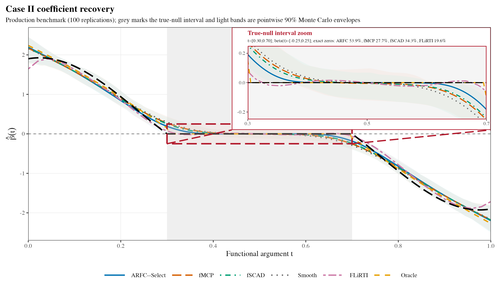

# AdaReFun 

### Smooth effects. Meaningful regions.


**R + RcppArmadillo · scalar-on-function regression · explicit validation**

`AdaReFun` is short for **Adaptive Regional Functional Regression**. It
provides adaptive regional sparsity methods for scalar-on-function linear
regression and contains the established fixed-resolution `fMCP()` and
`fSCAD()` estimators together with the proposed adaptive regional framework:

- ASR-MCP and ASR-SCAD: adaptive single-resolution regional penalties;
- AMR-MCP and AMR-SCAD: adaptive multi-resolution regional penalties;
- `arfc()`: one specified ASR/AMR and MCP/SCAD fit, with training BIC over its
  supplied tuning path;
- `arfc_select()`: independent-validation selection of exactly one of those
  four fits.

ARFC is the adaptive regional folded-concave estimator family. ARFC-Select
chooses one of its four members by validation MSE. The package also provides
fixed-resolution `fMCP()` and `fSCAD()` fits.

The model is

$$
Y_i = \mu + \int X_i(t)\beta(t)\,dt + \varepsilon_i,
$$

where each response $Y_i$ is paired with a curve $X_i(t)$ on the common
argument domain, $\mu$ is the intercept, $\beta(t)$ is the coefficient
function, and $\varepsilon_i$ is the residual error. The coefficient uses
a common B-spline representation. The regional penalty uses normalized
regional norms and domain-mass multipliers. In the multi-resolution fit,
nested regions share the same coefficient vector and level weights sum to one.

Matrix-intensive integration, regional Gram construction, norm evaluation,
local quadratic approximation, tuning-path fitting, active-set refitting,
effective degrees of freedom, and BIC calculations are implemented in C++17
with RcppArmadillo.

## Authors and citation

Developed by Bahadır Yüzbaşı and Jiguo Cao. Use `citation("AdaReFun")`
to cite the package.

Repository: [byuzbasi/AdaReFun](https://github.com/byuzbasi/AdaReFun).
See the [getting-started guide](vignettes/getting-started.Rmd),
[method guide](vignettes/methods-and-scope.Rmd),
[result gallery](vignettes/results-gallery.Rmd), and
[reproduction guide](vignettes/reproduction.Rmd).

## Installation

Install from GitHub with R 4.1 or later and a working C++17 compiler:

```r
# Install remotes first if it is not already available.
# install.packages("remotes")
remotes::install_github("byuzbasi/AdaReFun", build_vignettes = FALSE)
```

## Analysis scripts

The [replication code](replication/code) contains the simulation and real-data
run scripts. See the [run guide](REPRODUCIBILITY.md) for setup and commands.

### Simulation results



The inset shows coefficient recovery inside the true-null interval in Case II.
The [result gallery](vignettes/results-gallery.Rmd) also shows exact-zero
selection frequencies and the real-data analyses.

## Direct ARFC fit

```r
library(AdaReFun)

set.seed(2026)
n <- 60
argvals <- seq(0, 1, length.out = 51)
x <- matrix(rnorm(n * length(argvals)), n)
beta <- ifelse(argvals >= 0.35 & argvals <= 0.65, 0,
               1.5 * sin(2 * pi * argvals))
weights <- c(0.01, rep(0.02, 49), 0.01)
y <- 0.5 + as.numeric(x %*% (weights * beta)) + rnorm(n, sd = 0.15)

fit <- arfc(
  y, x, argvals,
  lambda = 10^seq(-4, -1, length.out = 8),
  kappa = 10^seq(-6, -3, length.out = 5),
  resolution = "multi",
  penalty = "MCP",
  levels = c(8L, 16L, 32L)
)

summary(fit)
plot(fit, type = "coefficient")
plot(fit, type = "weights")
predict(fit, x[1:5, , drop = FALSE])
```

## ARFC-Select with an explicit validation sample

```r
selection <- arfc_select(
  y[1:40], x[1:40, , drop = FALSE], argvals,
  validation = list(
    y = y[41:60],
    x = x[41:60, , drop = FALSE]
  ),
  lambda = 10^seq(-4, -1, length.out = 8),
  kappa = 10^seq(-6, -3, length.out = 5),
  levels = c(8L, 16L, 32L)
)

selection$selection
plot(selection, type = "validation")
plot(selection, type = "candidates")
```

`arfc_select()` fits candidates on the training data and uses the supplied
validation sample to choose the returned model.

## Fitting notes

Supply tuning grids through `lambda` and `kappa`. The package centers predictors
and responses and requires complete, finite inputs. Simpson integration uses
an equally spaced grid with an odd number of points; choose trapezoid
integration for an irregular grid. The tuning table reports convergence and
fit diagnostics. Default shapes are MCP `gamma = 2.7` and SCAD `a = 3.7`,
which have equal scalar maximum concavity.

## Established fixed-resolution estimators

The earlier interfaces remain available:

```r
fit_mcp <- fMCP(y, x, argvals, M = 20,
                lambda = c(0.002, 0.01), kappa = c(1e-5, 1e-4))
fit_scad <- fSCAD(y, x, argvals, M = 20,
                  lambda = c(0.002, 0.01), kappa = c(1e-5, 1e-4))
```

## References

- Fan, J., and Li, R. (2001). Variable selection via nonconcave penalized
  likelihood and its oracle properties. *Journal of the American Statistical
  Association*, 96(456), 1348-1360.
- Zhang, C.-H. (2010). Nearly unbiased variable selection under minimax
  concave penalty. *The Annals of Statistics*, 38(2), 894-942.
- Lin, Z., Cao, J., Wang, L., and Wang, H. (2017). Locally sparse estimator for
  functional linear regression models. *Journal of Computational and
  Graphical Statistics*, 26(2), 306-318.
