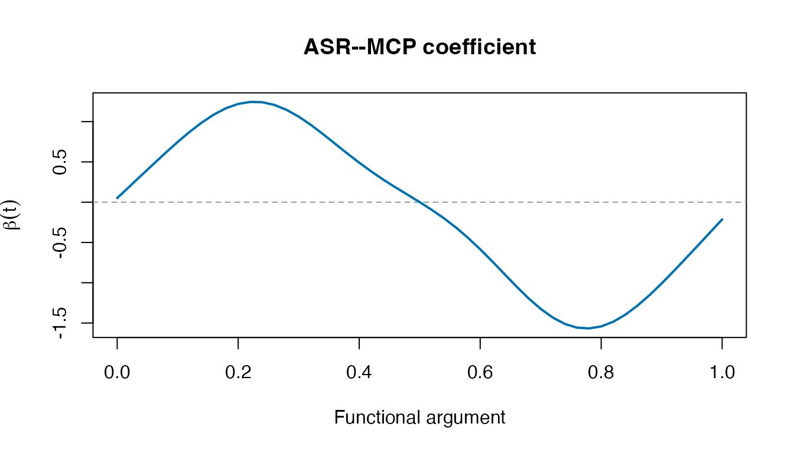

# Get started: from curves to regions

AdaReFun fits **scalar-on-function** regression: each row is a sampled
curve, and each curve has one scalar response. It is not a
function-on-scalar or function-on-function fitting interface.

## A small, reproducible demonstration

This artificial dataset illustrates the interface, not the paper’s
performance claims. The training/validation split is explicit. No test
set is used for selection. The modest tuning grids keep this example
short.

``` r

set.seed(2026)
t <- seq(0, 1, length.out=51)
n <- 60
scores <- matrix(rnorm(n*6), n, 6)
x <- scores %*% t(sapply(1:6, function(j) sin(j*pi*t)))
beta <- ifelse(t >= .35 & t <= .65, 0, 1.5*sin(2*pi*t))
w <- c(.01, rep(.02,49), .01)
y <- .5 + drop(x %*% (w*beta)) + rnorm(n, sd=.15)
```

`x` is an observations-by-grid matrix. `t` contains argument locations
on `[0,1]`; `beta` is the demonstration truth. The vector `w` is a
trapezoidal integration rule used only to generate the synthetic
response.

``` r

selection <- arfc_select(y[1:40], x[1:40,], t,
  validation=list(y=y[41:60], x=x[41:60,]),
  lambda=c(1e-4, 1e-3, 1e-2), kappa=c(1e-5, 1e-4),
  levels=c(4L,8L,16L))
selection$selection
#>     method     label resolution penalty tie_priority validation_response_mse
#> 1  asr_mcp  ASR--MCP     single     MCP            1              0.04018155
#> 2 asr_scad ASR--SCAD     single    SCAD            2              0.04018155
#> 3  amr_mcp  AMR--MCP      multi     MCP            3              0.04018155
#> 4 amr_scad AMR--SCAD      multi    SCAD            4              0.04018155
#>   difference_from_minimum tied selected
#> 1                       0 TRUE     TRUE
#> 2                       0 TRUE    FALSE
#> 3                       0 TRUE    FALSE
#> 4                       0 TRUE    FALSE
```

## Inspect the choice and its coefficient

``` r

plot(selection, type="validation")
```


``` r

plot(selection, type="coefficient")
```



[`arfc_select()`](https://byuzbasi.github.io/AdaReFun/reference/arfc_select.md)
returns one training-fitted model. It neither averages the four
candidates nor silently refits on the validation observations. For a
stated resolution and penalty, use
[`arfc()`](https://byuzbasi.github.io/AdaReFun/reference/arfc.md)
directly. Predictions use the training centering quantities:

``` r

head(predict(selection, x[41:60,]))
#> [1]  1.29714113 -0.04375299  0.40572326 -0.32381780  1.23279828  0.90044881
```

Read the method guide before interpreting exact zeros as structural
evidence. Finite-precision cutoff/refit conventions and convergence
diagnostics matter.
