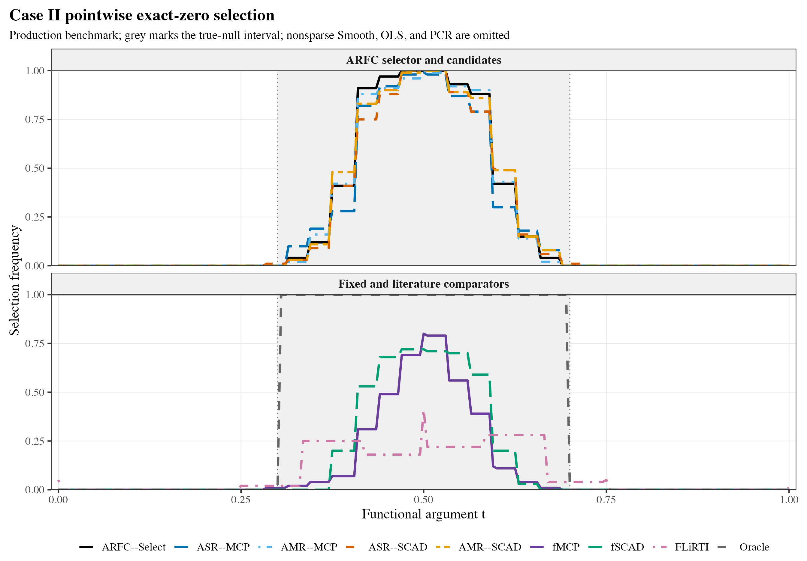
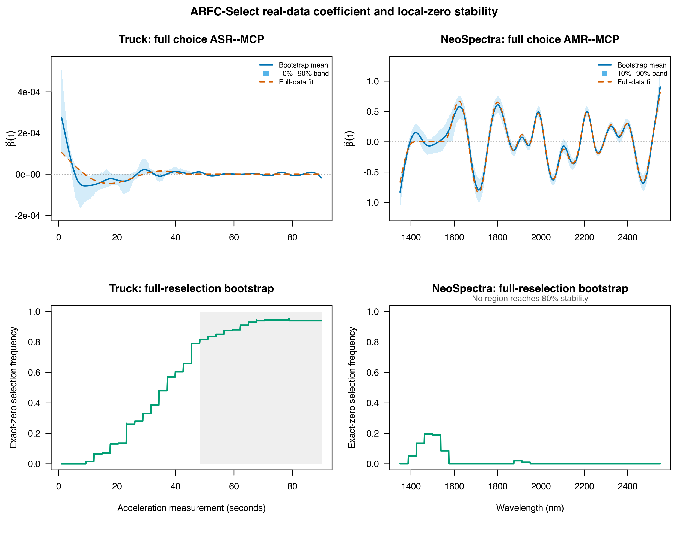

The simulations use 100 replications per coefficient case, with 150 training,
150 validation, and 2,000 independent test observations per replication.

## A coefficient mean is not a selection frequency

Nearly overlapping mean curves can conceal differences in exact-zero
selection. Light bands are pointwise 90% Monte Carlo envelopes, not confidence
bands for one observed dataset. ARFC-Select recovered 53.9% of the true-null
interval versus 27.7% for fixed fMCP and 34.3% for fixed fSCAD in this design.
The comparison is procedural: the selector uses additional independent
validation observations while fixed comparators use training-only tuning.

The script `simulation/59_refine_arfc_legacy_figures_v8.R` reproduces these
figures from the saved simulation results.

## Two empirical regimes

Truck identifies a stable late-time zero region, whereas NeoSpectra supports
competitive prediction without an 80%-stable zero interval. Structural
stability and prediction are different outcomes. Truth is unknown in these
applications, so true-zero recovery is not an empirical metric.

The real-data analysis uses 200 complete-reselection bootstrap fits per dataset.
The bands use the 10th and 90th percentiles
(pointwise 80%), distinct from the simulation envelopes above. Prediction
comparison intervals instead resample stored outer-CV prediction records and
do not include full retraining uncertainty. See the replication README for
figure-generation commands and data attribution.
